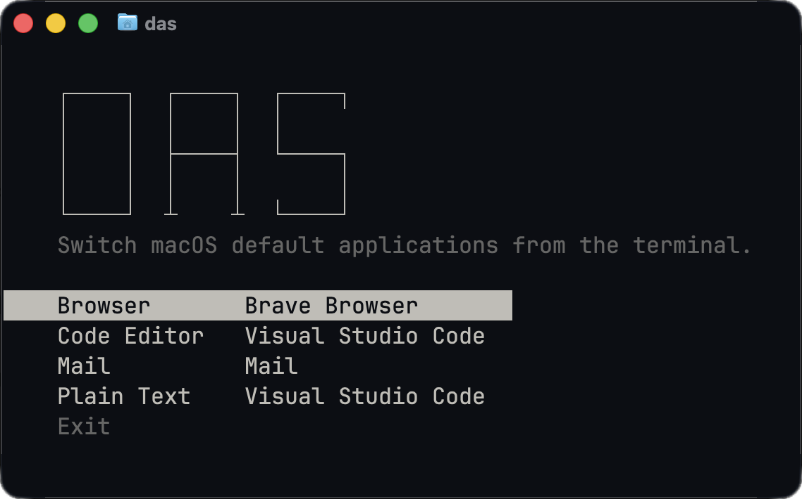

# Default App Switcher

Switch macOS default applications from the terminal.

## Why?

Choose your default `browser` and apps for web links, email links and file types in one terminal interface.

## Preview

## Requirements

Requires `macOS` and `Swift 6` or later to build from source.

## Guides

- [Manual Installation](docs/guides/Manual-Installation.md)
- [Troubleshooting](docs/guides/Troubleshooting.md)
